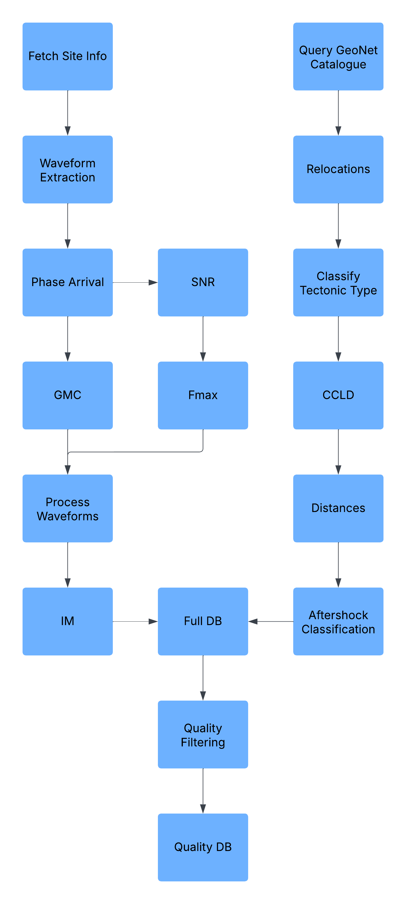

# Welcome to the NZGMDB WIKI

The present wikipage provides a detailed description of the pipeline used for the development of the New Zealand Ground Motion Database (NZGMDB), including its scientific background, the output file structure, and instructions for execution.

# 🌐 NZGMDB Pipeline Overview

The NZGMDB pipeline is split into two main concurrent tracks that handle:

- **Site data, waveform processing and Intensity Measure calculations**
- **Event metadata, aftershock and distance calculations**

Both tracks converge to integrate the data into the full database, followed by quality filtering.

Below is a breakdown of each stream and the merged steps.



---

## 🏠 Site Information Stream

### **Fetch Site Info**
Gathers all stations in the NZ network, including Vs30 and basin metadata.

### **Waveform Extraction**
Downloads miniSEED (mseed) raw waveforms from GeoNet using the FDSN Client.

### **Phase Arrival Detection**
Estimate P and S-wave arrival times using PhaseNet.

### **Signal-to-Noise Ratio (SNR)**
Calculates SNR from waveforms.

### **Fmax Calculation**
Determines max frequency (Fmax) from SNR data.

### **Ground Motion Classification (GMC)**
Classifies records (machine learning-based) to generate Fmin and quality metadata.

### **Process Waveforms**
Applies waveform processing (de-trend, de-mean, taper, etc.) and converts MSEED to ascii.

### **Intensity Measure (IM) Calculation**
Computes the intensity measures from the processed waveforms (PSA, PGV, PGA, FAS, CAV5, CAV, AI, Significant Durations, etc.)

---

## 💥 Event Metadata Stream

### **Query GeoNet Catalogue**
Pulls event metadata and origin times.

### **Relocations** *(internal step)*
Refines event locations based on relocation studies.

### **Classify Tectonic Type**
Adds tectonic classification for each event.

### **CCLD Calculation**
Infer fault planes using the CCLD method.

### **Compute Distances**
Compute hypocentral, epicentral, and source-to-site distances using the fault geometries.

### **Aftershock Classification**
Determines whether an event is an aftershock.

---

## 🔁 Merged Processing Stream

After both pipelines complete, the results are merged to perform the following:

### **Merge Full Database**
Combines all data into a unified database.

### **Quality Filtering**
Applies filtering rules to ensure only high-quality records are included.

### **Generate Final Quality DB**
Outputs a quality database flatfiles with all filtered records.

---

## ⚙️ Software Pipeline Execution
While the flowchart provides a conceptual overview of the NZGMDB pipeline's data dependencies, the actual software implementation is optimised for performance and diverges slightly from this sequential structure.

The pipeline is therefore composed of subtasks that can be run independently. These subtasks are listed below, along with links to their detailed documentation to explain what parts of the site and event streams the task invloves.

### 📡 Temporary Arrays
Data from temporary seismic deployments (IRIS, AUSPASS, ...) is bulk downloaded before the pipeline runs and read locally during waveform extraction. See **[Temporary Arrays](https://github.com/ucgmsim/nzgmdb/wiki/Temporary-Arrays)** for how to download it, add new periods and run the pipeline with it.

### 🧩 Subtasks
1. **[Fetching Site Table](https://github.com/ucgmsim/nzgmdb/wiki/Fetching-site-table)** (Gets all the sites in the NZ network domain and gathers their metadata, such as Vs30 and basin info)
2. **[Parse Geonet](https://github.com/ucgmsim/nzgmdb/wiki/Parse-Geonet)** (Fetches event metadata and station extraction information)
3. **[Waveform Extraction](https://github.com/ucgmsim/nzgmdb/wiki/Waveform-Extraction)** (Downloads raw waveforms from the FDSN Client and saves them as MSEED files)
4. **[Add Tectonic Domain](https://github.com/ucgmsim/nzgmdb/wiki/Add-Tectonic-Domain)** (Adds the tectonic classification to the earthquake source table and handles relocations)
5. **[Phase Arrival](https://github.com/ucgmsim/nzgmdb/wiki/Phase-Arrival)** (Estimates the P- and S-wave arrival times for records using PhaseNet)
6. **[Calculate SNR](https://github.com/ucgmsim/nzgmdb/wiki/Calculate-SNR)** (Computes SNR and FAS files)
7. **[Calculate Fmax](https://github.com/ucgmsim/nzgmdb/wiki/Calculate-Fmax)** (Computes Fmax from SNR data)
8. **[GMC](https://github.com/ucgmsim/nzgmdb/wiki/GMC)** (Machine Learning Model to classify records and produce Fmin and quality metadata)
9. **[Process records](https://github.com/ucgmsim/nzgmdb/wiki/Process-Records)** (Filters records based on GMC results and performs wave processing to turn mseeds into text files)
10. **[IM Calculation](https://github.com/ucgmsim/nzgmdb/wiki/IM-Calculation)** (Performs Intensity Measure Calculations and saves batched parquet results per component)
11. **[Calculate Distances](https://github.com/ucgmsim/nzgmdb/wiki/Calculate-Distances)** (Determines fault planes to calculate distance values for the propagation table)
12. **[Merge Aftershocks](https://github.com/ucgmsim/nzgmdb/wiki/Merge-Aftershocks)** (Merges aftershock classification into the earthquake source table)
13. **[Merge flatfiles](https://github.com/ucgmsim/nzgmdb/wiki/Merge-Flatfiles)** (Merges the IM batches and all flatfiles, removes filtered entries and splits the IM results per component into different flatfiles)
14. **[Quality DB](https://github.com/ucgmsim/nzgmdb/wiki/Quality-DB)** (Applies filters and generates the final quality database flatfiles with all filtered records)
15. **[Upload Dropbox](https://github.com/ucgmsim/nzgmdb/wiki/Upload-Dropbox)** (Optional, uploads the results to Dropbox)

Real-time / standalone:
- **[Real-Time Runs](https://github.com/ucgmsim/nzgmdb/wiki/Real-Time-Runs)** (Runs the pipeline for new GeoNet events as they happen, with Slack and SeismicNow updates)
- **[Auto CMT](https://github.com/ucgmsim/nzgmdb/wiki/Auto-CMT)** (Runs the automated multi-run 1-D CMT inversion for an event and selects the best solution, launched by the real-time pipeline or run manually for past events)

---

## 🗂️ File Structure

After a successful run of the NZGMDB pipeline, the output directory is organised into multiple top-level folders. Each contains files related to specific steps in the pipeline, following a consistent naming convention for ease of traceability and downstream analysis.

### 📁 Top-Level Directories

- **`flatfiles/`**  
  Contains the merged outputs for ground motion intensity measures (IMs), component-specific results, supporting metadata, and skipped record logs. The IM flatfiles are **parquet**, the other tables are CSV.

  **Final flatfiles** (written by Merge flatfiles, filtered to the records that made it through the pipeline):

  | File | Description |
  |------|-------------|
  | `earthquake_source_table.csv` | Source metadata for each event |
  | `earthquake_source_geometry.csv` | Fault geometry for each event, including strike, dip, rake, and full corner coordinates |
  | `site_table.csv` | Site metadata (e.g., Vs30, Z values) including if the site is within a basin |
  | `station_table.csv` | Station channel / location epochs |
  | `station_magnitude_table.csv` | Station magnitude values for each station-event-channel pair |
  | `station_extraction_table.csv` | Extraction metadata for each station-event pair |
  | `multi_event_table.csv` | Multi-event STA/LTA score and sync event flag per record |
  | `phase_arrival_table.csv` | P and S-wave picks from PhaseNet |
  | `propagation_path_table.csv` | Distance metrics (e.g., rrup, rjb, rx, ry) for each station-event pair |
  | `gmc_predictions.csv` | GMC classification results, including score and Fmin per record / component |
  | `fmax.csv` | Maximum frequency values per record and component (000, 090, ver) |
  | `snr_metadata.csv` | Metadata from SNR computation: Ds, Dn, delta, npts per record |
  | `ground_motion_im_table_<comp>_flat.parquet` | IMs with combined metadata (site, fmin, fmax, scores, source info) for `000`, `090`, `ver`, `geom`, `rotd0`, `rotd50`, `rotd100` |
  | `ground_motion_im_table_<comp>_orientation_flat.parquet` | Rotation angle (degrees) of each RotD0 / RotD100 IM, for `rotd0` and `rotd100` |
  | `ground_motion_im_table_<comp>_fas_flat.parquet` | FAS with combined metadata, for `000`, `090`, `ver`, `geom`, `eas` |

  **Pre-flatfiles** (the `_all` and per-step tables before merging): `earthquake_source_table_geonet.csv`, `earthquake_source_table_tectonic.csv`, `earthquake_source_table_distances.csv`, `earthquake_source_table_aftershocks.csv`, `earthquake_source_geometry_all.csv`, `station_extraction_table_geonet.csv`, `station_magnitude_table_extraction.csv`, `site_table_all.csv`, `station_table_all.csv`, `phase_arrival_table_all.csv`, `propagation_path_table_all.csv` and `prob_series.h5` (the full PhaseNet probability series for each record).

  **`im_merge_batch_dir/`**: the batched IM results from IM Calculation, one `im_merge_<component>/batch_<n>.parquet` dataset per component, plus `batch_records.csv` and `im_calc_skipped_records/`. Merge flatfiles reads these to build the IM flatfiles. See [IM Calculation](https://github.com/ucgmsim/nzgmdb/wiki/IM-Calculation).

  **Skipped / issue records** (record ID and the reason):

  | File | Stage |
  |------|-------|
  | `geonet_skipped_records.csv` | Fetching GeoNet data |
  | `extraction_skipped_records.csv` | Waveform extraction |
  | `clipped_records.csv` | Records clipped by ClipNet during waveform extraction |
  | `multi_trace_issue_records.csv` | Records with the "multi-trace" problem for the same channel, and their resolution |
  | `missing_sites.csv` | Sites with missing metadata (e.g., Vs30, basin info), filtered out in the quality database |
  | `phase_arrival_skipped_records.csv` | Phase arrival |
  | `snr_skipped_records.csv` | SNR calculation |
  | `fmax_skipped_records.csv` | Fmax calculation |
  | `gmc_skipped_records.csv` | GMC |
  | `processing_skipped_records.csv` | Waveform processing |
  | `im_calc_skipped_records.csv` | IM calculation |
  | `quality_skipped_records.csv` | Quality database filters |

- **`quality_db/`**  
  Includes final cleaned, filtered flatfiles used as a deliverable database for ground motion analysis. This is a subset of the `flatfiles/` directory, containing only records that passed all quality checks, and every file is saved as **CSV**. It holds the same final flatfiles as above (the IM, orientation and FAS flatfiles as `.csv`). See [Quality DB](https://github.com/ucgmsim/nzgmdb/wiki/Quality-DB) for the full list.

- **`waveforms/`**  
  Includes both raw and processed waveform data for every event, organised by year and event ID. Under each `event_id/`, there are two subfolders mseed and processed. Below shows the structure of the `waveforms/` directory and naming conventions used for files:

```
waveforms/
└── <year>/                        # e.g. 2022
    └── <event_id>/                # e.g. 2022p002924
        ├── mseed/
        │   └── <event_id>_<station>_<channel>_<location>.mseed
        │       # e.g. 2022p002924_DCZ_HN_20.mseed
        │
        └── processed/
            ├── <event_id>_<station>_<channel>_<location>.000
            ├── <event_id>_<station>_<channel>_<location>.090
            └── <event_id>_<station>_<channel>_<location>.ver
                # e.g.
                # 2022p002924_DCZ_HN_20.000
                # 2022p002924_DCZ_HN_20.090
                # 2022p002924_DCZ_HN_20.ver
```

- **`stationxml/`**  
  StationXML inventory for each station used, saved as `<network>.<station>.xml` (e.g. `NZ.DCZ.xml`) during waveform extraction and used for the response removal.

- **`fmax/`**  
  Fmax batch results (`batch_<n>/`), merged into `flatfiles/fmax.csv`.

- **`snr_fas/`**  
    Contains signal-to-noise ratio (SNR) and Fourier Amplitude Spectrum (FAS) calculations for each record. Files are organised first by year, then by event ID. Each file includes SNR and FAS data for a single waveform record.

```
snr_fas/
└── <year>/                                  # e.g. 2022
    └── <event_id>/                          # e.g. 2022p002924
        ├── <event_id>_<station>_<channel>_<location>_snr_fas.csv
        │   # e.g. 2022p002924_DCZ_HN_20_snr_fas.csv
        ├── ...
```

- **`gmc/`**  
  Holds machine learning classification outputs, including Fmin values and quality scores for each waveform record. Files are grouped into batch folders (e.g., batch_0, batch_1, etc.) based on the number of parallel processes (n_procs) used during processing. Each batch folder contains the list of processed record IDs, extracted features, classification results, and corresponding logs.

```
gmc/
├── batch_0/
│   ├── batch_0.txt                    # List of record IDs used in this batch
│   ├── features_comp_X.csv            # Extracted features for X comp (Y and Z will be similar)
│   ├── gmc_predictions.csv            # Final predictions with Fmin and quality scores
│   ├── extract_features.log           # Log file for feature extraction
│   └── predict.log                    # Log file for predictions
│
├── batch_1/
│   ├── batch_1.txt
│   ├── features_comp_X.csv
│   ├── gmc_predictions.csv
│   ├── extract_features.log
│   └── predict.log
│
├── ...
```

- **`phase_arrival/`**  
  Contains P and S-wave arrival picks derived using PhaseNet. The data is organised into batch folders (e.g., batch_0, batch_1, etc.) based on the number of processes used during execution. Each batch includes input record tracking, pick results, probability series data, and logs.

```
phase_arrival/
├── batch_0/
│   ├── batch_0.txt                  # List of record IDs processed in this batch
│   ├── phase_arrival_table.csv      # Final P and S-wave picks with metadata
│   ├── prob_series.h5               # HDF5 file with full probability series from PhaseNet
│   ├── run_phasenet.log             # Log file from PhaseNet run
│   └── skipped_records.csv          # Records skipped and reasons why
│
├── batch_1/
│   ├── batch_1.txt
│   ├── phase_arrival_table.csv
│   ├── prob_series.h5
│   ├── run_phasenet.log
│   └── skipped_records.csv
│
├── ...
```